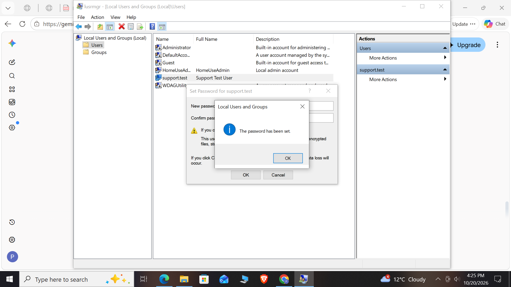
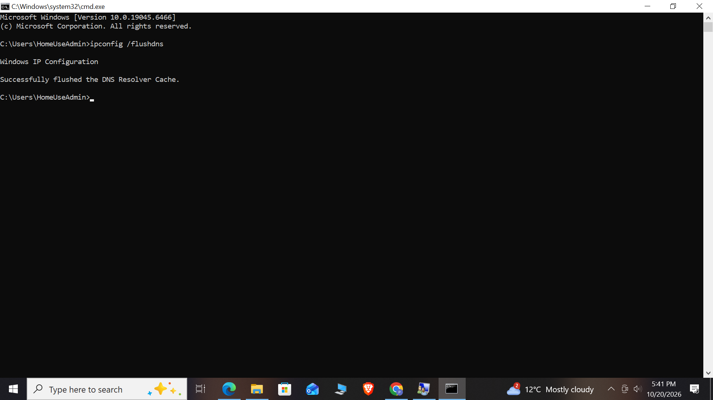
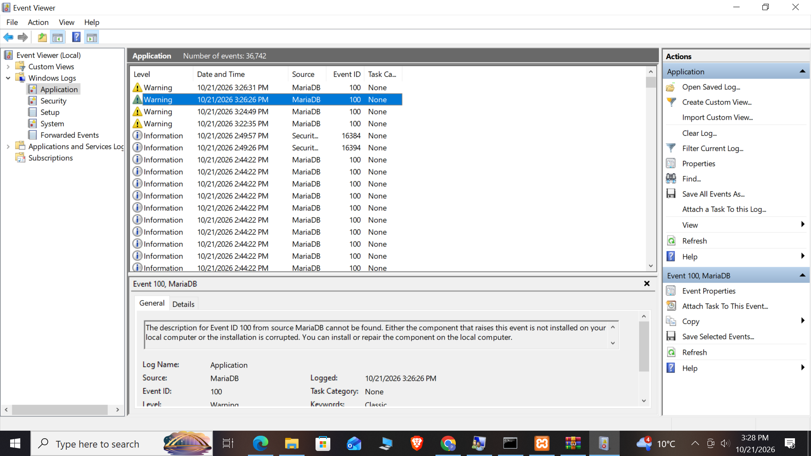

## ## Hands-On Lab Proof: Tier 1 Password Reset & Account Recovery
* **Scenario:** A corporate user ('support.test') contacted the help desk locked out of their local workstation after multiple incorrect login attempts.
* **Action Taken:** Accessed Windows Local Users and Groups (`lusrmgr.msc`), bypassed stale lockout attributes by performing an administrative credential reset, and provided temporary access.
* **Proof of Work:**

## ## Hands-On Lab Proof: System Stability & Crash Diagnostics
* **Scenario:** A user reports intermittent system performance issues and software instability on a windows workstation.
* **Action Taken:** Launched Windows Reliability Monitor (`perfmon /rel`) to analyze historical system stability, review application/Windows failures, and trace warning event logs.
* **Proof of Work:**

## 📸 Hands-On Lab Proof: Network DNS Cache Flushing (`ipconfig /flushdns`)
* **Scenario:** A user reported being unable to access an internal company web portal due to stale network routing records.
* **Action Taken:** Opened an elevated command prompt, executed `ipconfig /flushdns` to clear out corrupted DNS resolver records, and re-established clean name resolution.
* **Proof of Work:**

# Incident Report: INC-9942 - Application Fault Isolation

* **Incident ID:** INC-9942
* **Priority:** P2 - High
* **Status:** Resolved / Closed
* **System Diagnosed:** Local Windows Workstation (`AST-8821`)

## Incident Overview
User reported application instability and unexpected crashes during startup.

## Troubleshooting & Resolution Steps
1. Launched **Event Viewer** (`eventvwr.msc`) to inspect system and application logs.
2. Isolated application error source under `Windows Logs > Application`.
3. Verified error signatures, cleared temporary cache files, and successfully validated application stability.

## Proof of Work

